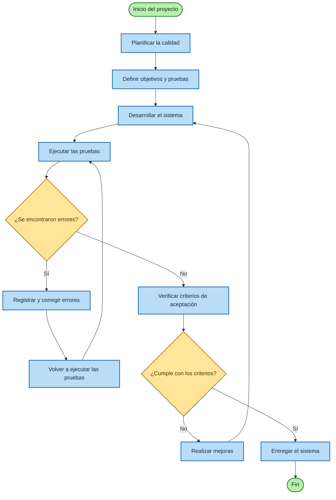

# Plan de Calidad de Software
## Sistema de Punto de Venta para una Papelería

## 1. ¿Qué es un plan de calidad?

Un **plan de calidad de software** es un documento que establece las actividades, normas, métodos y pruebas que se realizarán para garantizar que un sistema cumpla con los requisitos establecidos y funcione correctamente.

Su objetivo es prevenir errores, detectar problemas y asegurar que el software sea confiable, seguro y fácil de utilizar.

## 2. ¿Para qué sirve?

- Detectar errores durante el desarrollo.
- Comprobar que el sistema cumple con los requerimientos.
- Mejorar la seguridad del software.
- Garantizar que las funciones trabajen correctamente.
- Reducir fallos.
- Mejorar la experiencia del usuario.
- Establecer criterios de aceptación.

## 3. Elementos de un plan de calidad

| Elemento | Descripción |
|---|---|
| Objetivo | Define qué se busca garantizar. |
| Alcance | Indica qué partes serán evaluadas. |
| Requerimientos de calidad | Características que debe cumplir el sistema. |
| Métodos de prueba | Cómo se comprobará el funcionamiento. |
| Responsables | Quién realizará las pruebas. |
| Herramientas | Programas usados para verificar la calidad. |
| Criterios de aceptación | Cuándo una función se considera correcta. |
| Registro de errores | Documentación de problemas y soluciones. |

## 4. Ejemplo aplicado a Novedades Ale

- **Nombre:** Sistema de Punto de Venta para la Papelería Novedades Ale.
- **Objetivo:** Garantizar el registro de ventas, el control del inventario y la generación de comprobantes.
- **Alcance:** Inicio de sesión, productos, ventas, pagos, inventario y tickets.
- **Responsable:** Equipo de desarrollo.

## 5. Ejemplos de pruebas de calidad

### Prueba 1: Inicio de sesión

**Objetivo:** Comprobar que el usuario ingrese con datos válidos.

**Resultado esperado:** Se permite el acceso con credenciales correctas y se muestra un error con credenciales incorrectas.

### Prueba 2: Registro de una venta

**Objetivo:** Verificar que el sistema registre una compra.

**Resultado esperado:** La venta se guarda con productos, cantidades y total.

### Prueba 3: Actualización del inventario

**Objetivo:** Comprobar que las existencias se actualicen después de una venta.

**Resultado esperado:** Se descuenta la cantidad de productos vendidos.

### Prueba 4: Cálculo del total

**Objetivo:** Verificar el cálculo de los precios y cantidades.

**Resultado esperado:** El total coincide con la suma de los productos.

### Prueba 5: Generación del ticket

**Objetivo:** Comprobar que se genere el comprobante.

**Resultado esperado:** El ticket muestra productos, total e información de la compra.

## 6. Características de calidad

| Característica | Ejemplo |
|---|---|
| Funcionalidad | El sistema registra ventas correctamente. |
| Usabilidad | El cajero utiliza la interfaz con facilidad. |
| Rendimiento | El sistema responde rápidamente. |
| Seguridad | El acceso de usuarios está protegido. |
| Mantenibilidad | El código puede modificarse con facilidad. |
| Fiabilidad | El sistema funciona de forma consistente. |

## 7. Tabla de pruebas

| ID | Prueba | Resultado esperado | Estado |
|---|---|---|---|
| P01 | Inicio de sesión válido | Acceso al menú principal | Pendiente |
| P02 | Registrar una venta | Venta guardada | Pendiente |
| P03 | Calcular total | Total correcto | Pendiente |
| P04 | Actualizar inventario | Existencias actualizadas | Pendiente |
| P05 | Generar ticket | Comprobante generado | Pendiente |

> El estado “Pendiente” debe cambiarse a “Aprobada” o “No aprobada” después de realizar cada prueba.

## 8. Flujo del plan de calidad en Mermaid

## 9. Etapas

1. **Planificar:** Se definen los objetivos y las pruebas.
2. **Desarrollar:** Se programa el sistema siguiendo los requerimientos.
3. **Probar:** Se ejecutan las pruebas de cada módulo.
4. **Corregir:** Se solucionan los errores.
5. **Verificar:** Se comprueba el cumplimiento de los criterios.
6. **Entregar:** Se entrega el sistema cuando cumple los requisitos.

## 10. Resumen y conclusión

Un plan de calidad establece las actividades, pruebas y criterios necesarios para garantizar que un sistema cumpla con sus requerimientos y funcione correctamente.

En un punto de venta, permite comprobar que las ventas se registren correctamente, los totales se calculen sin errores y el inventario se actualice después de cada compra.

El plan de calidad ayuda a entregar un sistema más confiable, seguro, funcional y adecuado para las necesidades de la papelería.
